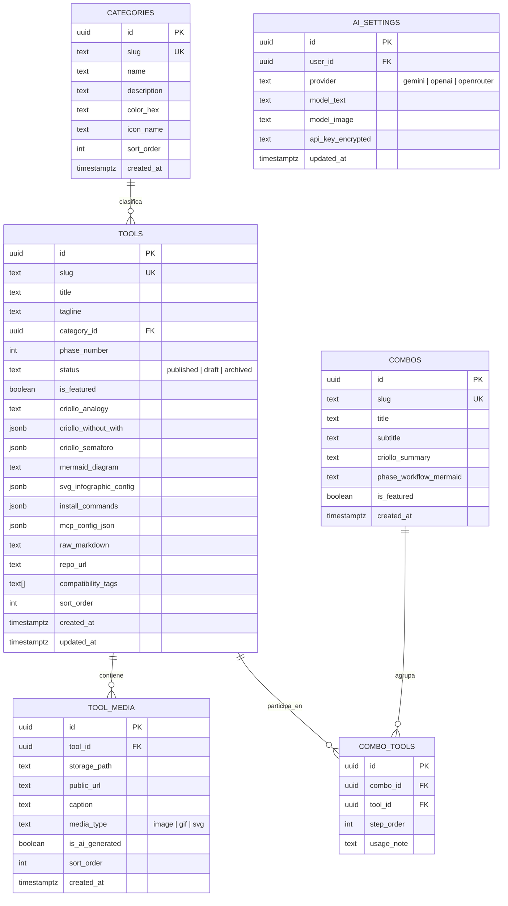

# Especificación Maestra de Arquitectura y Sistema — BoxTools (PEVC V5)

**Proyecto:** `BoxTools` — El Baúl e Índice Visual de Ingeniería IA para el Equipo  
**Metodología:** Vibe Coding Profesional (PEVC V5)  
**Estado:** Pendiente de Aprobación del Usuario (Fase 1 - Paso 3)  
**Fecha:** 2026-11-08  

---

## 1. Visión General y Propósito del Sistema

`BoxTools` es una plataforma web centralizada para un equipo de desarrollo asistido por IA que recopila, estructura y explica todas las herramientas de creación de sistemas con IA: **Skills Agénticas**, **Servidores MCP**, **Markdowns / Workflows personalizados** (como PEVC V5), **Baúl de Herramientas / Apps IA**, **Combos / Stacks** y **Reglas / Prompts (`.clauderules`, `AGENTS.md`)**.

### Diferenciadores Clave
1. **Doble Nivel de Explicación ("Modo Criollo 🧉" vs. "Modo Técnico ⚙️"):**
   - **Modo Criollo (Vulgar / Didáctico):** Explica cada herramienta sin tecnicismos mediante analogías de la vida real, comparativas visuales (*"Sin esto 💀 vs. Con esto 🚀"*), un semáforo práctico (*"🟢 Cuándo usarla sí o sí vs. 🔴 Cuándo NO / Errores comunes"*), diagramas de flujo interactivos generados por código (`Mermaid.js`), infografías SVG Neo-Brutalistas y galería de imágenes/GIFs con Lightbox/Zoom.
   - **Modo Técnico (Implementación Directa):** Provee comandos de instalación en 1 clic por entorno (`Antigravity`, `OpenCode`, `Cursor`, `Claude Code`, `Terminal`), configuración JSON de servidores MCP lista para copiar, variables de entorno requeridas, y un **Visor Dual de Markdown** (*Vista Formateada con Diagrama de Fases* vs. *Código Raw `.md`*) con descarga directa de archivos `.md`.
2. **Motor de Auto-Ingesta y Generación con IA (API Key en Panel Admin):**
   - El Administrador pega un link de GitHub, el contenido de un `README.md`, un archivo `.md` o notas sueltas, y mediante **Google Gemini API** (Texto + Imagen/Nano Banana con una sola API Key) u **OpenAI / OpenRouter**, el sistema estructura automáticamente todos los campos técnicos, redacta la explicación en criollo, escribe el código del gráfico `Mermaid` + configuración de infografía SVG, y genera ilustraciones guardándolas en **Supabase Storage**.
   - Incluye un **Fallback Gráfico Automático**: si la API de imagen falla, no tiene saldo o no hay API Key configurada, el sistema genera por código una **Infografía Visual SVG Neo-Brutalista + Diagrama Mermaid** para que jamás exista un hueco visual vacío.
3. **Precarga de Fábrica (Seed Completo PEVC V5):**
   - El sistema viene precargado en Supabase con las **11 Skills de PEVC V5** (`superpowers`, `ECC`, `find-skills`, `frontend-design`, `stitch`, `impeccable`, `supabase`, `playwright/webapp-testing`, `compose-preview`, `android-cli`, `android-device-hub`), los **Servidores MCP** (`Google Stitch MCP`, `Supabase Cloud MCP`, `Playwright MCP`), el **Workflow Maestro `PEVC V5.md`**, y las herramientas principales del ecosistema, todo explicado tanto en Modo Criollo como en Modo Técnico.

---

## 2. Módulos y Reglas de Negocio

### RN-01: Control de Acceso y Roles
- **Catálogo Público (Sin Login):** Cualquier miembro del equipo accede libremente a todas las vistas de lectura, buscador (`Ctrl+K`), filtros, switch Modo Criollo / Modo Técnico, copia de comandos/JSON/Markdown al portapapeles, descarga de archivos `.md`, Ruta de Onboarding y Armador de Setup (Combos).
- **Panel Admin Privado (`/admin/*`):** Protegido mediante **Supabase Auth** (`email + password`). Solo usuarios autenticados como administradores pueden crear, editar, eliminar o cambiar el estado de publicación de herramientas, subir archivos a Supabase Storage, gestionar Combos, importar/exportar backups JSON y configurar las API Keys de IA.

### RN-02: Organización por Categorías y Fases SDLC
- **6 Categorías Oficiales con Identidad Cromática Neo-Brutalista:**
  1. `skills` — **Skills Agénticas** (Amarillo Eléctrico `#FACC15`)
  2. `mcps` — **Servidores MCP** (Cian Vibrante `#06B6D4`)
  3. `workflows` — **Markdowns / Workflows** (Coral / Naranja `#FF6B35`)
  4. `tools` — **Baúl de Apps / Herramientas IA** (Verde Menta `#10B981`)
  5. `combos` — **Recetas / Combos (Stacks)** (Rosa / Magenta `#EC4899`)
  6. `rules` — **Reglas y Prompts (`.clauderules`, `AGENTS.md`)** (Violeta `#8B5CF6`)
- **Clasificación por Fase del Flujo de Trabajo (PEVC V5):**
  - `Fase 0`: Setup, Instalación de Skills y Conexión de MCPs
  - `Fase 1`: Brainstorming Socrático y Especificación (`docs/specs/`)
  - `Fase 2`: Diseño UI/UX (`frontend-design` + `Stitch` + `Playwright` + `Impeccable`)
  - `Fase 3`: Base de Datos Cloud (`Supabase`) y Desarrollo TDD (`ROJO -> VERDE -> AZUL`)
  - `Fase 4`: Pruebas E2E, Auditoría de Seguridad (`AgentShield`) y Entrega
  - `Transversal`: Uso en cualquier momento del proyecto

### RN-03: Regla de Completitud Visual ("Cero Huecos Gráficos")
- Toda herramienta publicada **DEBE** contar con apoyo gráfico en el Modo Criollo:
  - Si tiene imágenes en `tool_media` (subidas manualmente o generadas con IA en Supabase Storage), se muestran en la galería principal con visor **Lightbox + Zoom**.
  - Si no tiene imágenes de mapa de bits o si la generación de imagen por IA falla por cuota/red, el componente renderiza automáticamente la **Infografía SVG Neo-Brutalista generada por código** (basada en `svg_infographic_config`) junto con el **Diagrama de Flujo Interactivo (`Mermaid.js`)**.

### RN-04: Motor de Auto-Ingesta y Regeneración por IA
- Desde `/admin/editor`, el Admin puede ingresar texto crudo, pegar el contenido de un `.md` o indicar el repositorio/nombre de una herramienta y pulsar **"✨ Auto-Organizar y Generar con IA"**.
- El motor consulta la API configurada (`Gemini API` por defecto o `OpenAI / OpenRouter`) con un esquema JSON estricto (`responseSchema`) que devuelve:
  - `title`, `slug`, `tagline`, `category_slug`, `phase_number`, `compatibility_tags`
  - `criollo_analogy` (explicación en lenguaje coloquial / metáfora de barrio)
  - `criollo_without_with` (`{ without_pain: string[], with_solution: string[] }`)
  - `criollo_semaforo` (`{ green_when_to_use: string[], red_when_not_to_use: string[] }`)
  - `mermaid_diagram` (código `flowchart LR` o `flowchart TD` válido)
  - `svg_infographic_config` (pasos visuales `input -> process -> output`, iconos y etiquetas cortas para renderizar infografía SVG Neo-Brutalista)
  - `install_commands` (comandos para `antigravity`, `opencode`, `cursor`, `claude_code`, `npx`)
  - `mcp_config_json` (si aplica) y `raw_markdown` (guía técnica completa o contenido del workflow `.md`).
- Además, cada sección del editor cuenta con un botón **"🔄 Regenerar sección con IA"** para refinar únicamente la analogía, el gráfico Mermaid o la ilustración sin sobrescribir el resto.

### RN-05: Armador de Setup ("Mi Mochila / Combo Personalizado")
- Cualquier miembro del equipo puede marcar herramientas desde el catálogo con el botón **"+ Sumar a mi Combo"**.
- El Drawer lateral **"Armador de Setup"** recopila las herramientas seleccionadas y genera en tiempo real:
  1. Un **Script Único de Instalación** (PowerShell / Bash) con todos los comandos `npx skills add` / `agy plugin install` combinados.
  2. Un **JSON Unificado de `mcpServers`** combinando todos los MCP seleccionados.
  3. Un botón **"📥 Descargar Playbook `.md` del Combo"** que empaqueta las instrucciones y flujos seleccionados en un único archivo Markdown listo para pasarle al agente.

---

## 3. Pila Tecnológica (Definida en Etapa B)

| Capa | Tecnología Elegida | Propósito |
| :--- | :--- | :--- |
| **Frontend Framework** | **React 19 + Vite + TypeScript** | SPA ultrarrápida, tipado estricto y modularidad limpia |
| **Estilos y UI** | **Tailwind CSS + Sistema Neo-Brutalista ("Visual Playbook")** | Bordes sólidos marcados, sombras desplazadas duras (`shadow-brutal`), modo claro cálido (`#FFFDF7`) y modo oscuro (`#121316`) |
| **Gráficos por Código** | **Mermaid.js + Generador Infográfico SVG React** | Diagramas de flujo interactivos con zoom y láminas infográficas generadas por código |
| **Iconografía** | **Lucide React** | Iconos técnicos y didácticos consistentes |
| **Renderizado Markdown** | **React Markdown + Remark GFM + Visor Raw/Formatted** | Renderizado de workflows `.md` (como PEVC V5) y descarga directa |
| **Backend & Base de Datos** | **Supabase Cloud (PostgreSQL + RLS — 100% Sin Docker)** | Persistencia relacional, políticas RLS, tipos autogenerados `database.types.ts` |
| **Autenticación** | **Supabase Auth** | Login seguro para el Panel Admin privado |
| **Almacenamiento Multimedia** | **Supabase Storage (Bucket `tool-media`)** | Almacenamiento de infografías, capturas, GIFs e imágenes generadas por IA |
| **Motor de IA** | **Google Gemini API (`@google/genai` / REST) + OpenAI/OpenRouter** | Estructuración JSON, redacción Modo Criollo/Técnico, diagramas Mermaid e imágenes IA |
| **Testing & Diagnóstico** | **Playwright (`webapp-testing`)** | Capturas en 1440px, 768px, 375px, inspección DOM y pruebas E2E TDD |

---

## 4. Dirección Estética y UX (`Visual Playbook / Neo-Brutalista` — Etapa C)

### 4.1 Paleta de Colores y Tokens Base
- **Modo Claro ("Warm Paper Playbook" — Predeterminado o conmutable):**
  - Fondo Principal: `#FFFDF7` (Crema Papel Ilustrado)
  - Fondo Secundario / Superficies: `#F4EFE6` (Arena Suave)
  - Tarjetas: `#FFFFFF` con borde `#111827` de `2.5px` y sombra dura `4px 4px 0px #111827`
  - Texto Principal: `#111827` (Tinta Negra Profunda)
  - Texto Secundario: `#374151`
- **Modo Oscuro ("Night Blueprint Vault"):**
  - Fondo Principal: `#121316` (Carbón Profundo)
  - Fondo Secundario / Superficies: `#1C1E24`
  - Tarjetas: `#23262F` con borde `#F9FAFB` de `2px` y sombra dura `4px 4px 0px #000000`
  - Texto Principal: `#F9FAFB`
  - Texto Secundario: `#D1D5DB`
- **Colores de Acento por Categoría:**
  - **Skills (`skills`):** `#FACC15` (Amarillo Eléctrico)
  - **MCPs (`mcps`):** `#22D3EE` (Cian Vibrante)
  - **Workflows `.md` (`workflows`):** `#FF6B35` (Naranja / Coral)
  - **Apps / Herramientas (`tools`):** `#34D399` (Verde Menta)
  - **Combos / Stacks (`combos`):** `#F472B6` (Rosa Intenso)
  - **Reglas / Prompts (`rules`):** `#A78BFA` (Violeta)

### 4.2 Tipografía
- **Títulos y Encabezados (`Display`):** `'Space Grotesk'`, sans-serif (`font-bold` / `font-extrabold`, tracking ajustado).
- **Cuerpo de Lectura (`Body`):** `'Plus Jakarta Sans'` o `'Inter'`, sans-serif (alta legibilidad tanto en explicaciones en criollo como en tablas).
- **Código, Comandos CLI y Archivos `.md` (`Mono`):** `'JetBrains Mono'`, monospace.

### 4.3 Comportamiento Responsive (Desktop 1440px, Tablet 768px, Mobile 375px)
- **Desktop (`1440px`):** Sidebar izquierda fija (`280px`) estilo *"Índice de Manual Ilustrado"* con navegación por Categorías, filtro por Fases (Fase 0 a Fase 4) y acceso rápido a Onboarding y Combos. Topbar superior con Buscador `Ctrl+K`, Switch prominente **"🧉 Modo Criollo / ⚙️ Modo Técnico"**, botón del Armador de Setup (con contador badge) y Switch de Tema Claro/Oscuro.
- **Tablet (`768px`):** Sidebar colapsable en Drawer lateral con overlay; grilla de tarjetas en 2 columnas; diagramas con contenedor scrollable horizontal seguro.
- **Mobile (`375px`):** Header compacto superior con botón Menú Hamburguesa (abre Drawer táctil de ancho completo), Switch compacto **"🧉 Criollo / ⚙️ Técnico"** siempre accesible arriba, barra horizontal deslizable para filtros rápidos, tarjetas en 1 columna sin desbordamiento horizontal (`scrollWidth <= clientWidth`), y botones táctiles de al menos `44px x 44px`.

---

## 5. Inventario Completo de Pantallas, Menús y Componentes UI

### 5.1 Pantallas Públicas (Equipo)
1. **Vista Principal — Explorador del Baúl (`/`)**
   - **Hero Playbook Banner:** Resumen visual de cómo funciona el ecosistema IA del equipo, con botón directo a *"🚀 Ver Workflow Maestro PEVC V5"* y *"🧭 Guía para Nuevos (Onboarding)"*.
   - **Barra de Control y Filtros:**
     - Selector de Fase SDLC (`Todas`, `Fase 0: Setup`, `Fase 1: Brainstorming`, `Fase 2: Diseño UI`, `Fase 3: DB & TDD`, `Fase 4: QA & Cierre`).
     - Chips de Compatibilidad (`Antigravity`, `OpenCode`, `Cursor`, `Claude Code`).
   - **Grilla de Tarjetas Neo-Brutalistas (`ToolCard`):**
     - Muestra badge de Categoría (con su color), badge de Fase, Título, Tagline.
     - **Vista Dinámica según el Switch Global:**
       - Si está en **🧉 Modo Criollo:** Muestra la caja de *"Analogía Rápida"* con miniatura de infografía/ilustración y el resumen *"Para qué te salva las papas"*.
       - Si está en **⚙️ Modo Técnico:** Muestra directamente el comando CLI copiable en 1 clic y los tags de compatibilidad.
     - Footer de tarjeta con botones: **"Ver Explicación y Gráficos"**, **"📋 Copiar Comando"** y **"+ Mi Combo"**.

2. **Vista de Detalle de Herramienta (`/tool/:slug`)**
   - **Header de Ficha:** Breadcrumb, Categoría, Fase SDLC, Título, Enlace al repositorio oficial, Botón **"📥 Descargar `.md`"** (si tiene markdown), Botón **"+ Sumar a mi Combo"**, y el Switch Grande **"🧉 Explicación en Criollo (Con Gráficos)"** vs. **"⚙️ Guía Técnica e Instalación"**.
   - **Sección A — Modo Criollo Ilustrado:**
     - **Bloque 1: "En Criollo / Metáfora de Barrio":** Tarjeta destacada con ilustración/infografía y explicación coloquial sin jerga.
     - **Bloque 2: Infografía Visual + Diagrama de Flujo (`Mermaid` + `SVG Infographic`):** Muestra el flujo visual de cómo entra la información, qué hace la herramienta por dentro y qué resultado entrega, con controles de Zoom / Pantalla Completa.
     - **Bloque 3: Galería de Imágenes / Capturas (`Supabase Storage`):** Miniaturas clicables que abren el **Modal Lightbox con Zoom**.
     - **Bloque 4: Comparativa "Sin esta herramienta 💀 vs. Con esta herramienta 🚀":** Dos columnas contrastadas (Rojo Coral vs. Verde Menta).
     - **Bloque 5: Semáforo del Team ("🟢 Cuándo usarla sí o sí" vs. "🔴 Cuándo NO usarla / Errores comunes").**
   - **Sección B — Modo Técnico y Markdown:**
     - **Selector de Entorno CLI:** Pestañas para copiar el comando exacto en `Antigravity`, `OpenCode / NPX`, `Cursor`, `Claude Code`.
     - **Configuración Servidor MCP (si aplica):** Bloque JSON formateado con botón **"📋 Copiar JSON"** y lista de variables de entorno requeridas (ej. `SUPABASE_ACCESS_TOKEN`).
     - **Visor Dual de Markdown (`Formatted Preview` / `Raw .md Code`):** Renderiza el documento completo (como `PEVC V5.md`) con tabla de contenidos, resaltado de código, botón **"📋 Copiar Todo el Markdown"** y botón **"📥 Descargar Archivo `.md`"**.

3. **Vista de Combos / Recetas y Workflows (`/combos`)**
   - Lista de Stacks prearmados para el equipo (ej. *"Stack Completo PEVC V5 Web + Supabase Cloud"*, *"Stack Auditoría Visual Stitch + Playwright + Impeccable"*, *"Stack Mobile Android Compose"*).
   - Cada Combo muestra su diagrama de cómo se conectan las herramientas entre sí y un botón **"⚡ Cargar este Combo en mi Armador"** o **"📥 Descargar Playbook Completo (`.md`)"**.

4. **Vista Ruta de Onboarding / Academia Visual (`/onboarding`)**
   - Mapa interactivo de las **5 Etapas para dominar el Vibe Coding Profesional en el Team**:
     1. *¿Qué diferencia hay entre una Skill, un MCP y un Workflow Markdown? (Explicado con dibujos y analogías de taller mecánico/cocina).*
     2. *Cómo fluye un proyecto en PEVC V5 (De Fase 0 a Fase 4).*
     3. *Reglas de Oro del Equipo (Cero Docker para Supabase, Prohibido programar sin aprobar capturas de Playwright + Impeccable, TDD Semáforo Rojo-Verde-Azul).*

### 5.2 Componentes Globales, Modales y Estados ("Casos Invisibles")
- **Modal Buscador Rápido (`Ctrl+K` / `CommandPalette`):** Busca en tiempo real por título, comando técnico, categoría o frase en criollo (ej. escribir *"fotos pantalla"* encuentra `playwright`, escribir *"sin docker"* encuentra `supabase`).
- **Drawer "Armador de Setup / Mi Combo" (`SetupBuilderDrawer`):** Panel deslizable derecho donde el usuario ve las herramientas elegidas, copia el script unificado de instalación o descarga el `.md` combinado.
- **Modal Lightbox de Imágenes y Gráficos (`MediaLightboxModal`):** Visor a pantalla completa con controles de Zoom (`+`, `-`, `Reset`), título y nota explicativa al pie.
- **Estados Vacíos (`EmptyStateBrutal`):** Ilustración SVG Neo-Brutalista cuando un filtro o búsqueda no arroja resultados, con botón **"Limpiar todos los filtros"**.
- **Estados de Carga (`SkeletonBrutal`) y Notificaciones (`ToastBrutal`):** Skeletons con bordes marcados durante consultas y Toasts Neo-Brutalistas de confirmación (*"¡Comando copiado!"*, *"¡Archivo .md descargado!"*, *"Error de cuota en API IA: activado Fallback Gráfico SVG"*).

### 5.3 Pantallas del Panel Admin Privado (`/admin/*`)
1. **Login de Administrador (`/admin/login`):**
   - Formulario Neo-Brutalista autenticado contra Supabase Auth con manejo de errores de credenciales y redirección segura.
2. **Dashboard Admin de Recursos (`/admin`):**
   - Estadísticas rápidas (Total Recursos, Por Categoría, Con Gráficos IA), buscador interno, filtro por estado (`Publicado`, `Borrador`, `Destacado`), acciones rápidas (`Editar`, `Duplicar`, `Cambiar Estado`, `Eliminar` con **Modal de Confirmación**) y botones **"📥 Exportar Backup JSON"** / **"📤 Importar Backup JSON"**.
3. **Editor En Vivo + Auto-Ingesta Mágica con IA (`/admin/editor/:id?`):**
   - **Panel Superior "✨ Auto-Ingesta Mágica con IA":** Textarea para pegar URL de GitHub, README o arrastrar un archivo `.md`, selector de qué generar (*"Todo Completo"*, *"Solo Explicación Criolla + Gráfico"*, *"Generar Ilustración IA"*), e indicador de progreso paso a paso.
   - **Formulario Completo Dividido + Vista Previa en Vivo (`Split View`):**
     - Datos generales (Título, Slug, Categoría, Fase, Estado, Destacado).
     - Secciones Modo Criollo (Analogía, Sin vs. Con, Semáforo Verde/Rojo).
     - Editor de Gráfico por Código (`Mermaid.js` + Configuración de Infografía SVG con previsualización instantánea y botón *"🔄 Regenerar Gráfico con IA"*).
     - Gestor de Imágenes (`Drag & Drop` hacia Supabase Storage `tool-media` + botón *"🎨 Generar Ilustración con IA"*).
     - Secciones Modo Técnico (Comandos por IDE, JSON MCP, Editor Markdown con carga de archivo `.md`).
   - **Protección contra pérdida de cambios:** Alerta/Modal de confirmación si el Admin intenta salir con cambios sin guardar.
4. **Ajustes del Motor de IA (`/admin/settings`):**
   - Selector de Proveedor Principal (`Google Gemini API`, `OpenAI API`, `OpenRouter`).
   - Campo seguro de API Key (opción de guardar en tabla protegida por RLS `ai_settings` en Supabase o solo en almacenamiento local del navegador del Admin).
   - Selector de Modelo de Texto (ej. `gemini-2.5-flash` / `gemini-2.5-pro` / `gpt-4o`) y Modelo de Imagen (ej. `imagen-3.0-generate-002` / `gemini-2.0-flash-preview-image-generation`).
   - Botón **"🔌 Probar Conexión y Modelos"** con diagnóstico en vivo.

---

## 6. Esquema Entidad-Relación y Políticas RLS (`Supabase Cloud`)

### 6.1 Diagrama Entidad-Relación (`Mermaid ER`)

### 6.2 Políticas `ROW LEVEL SECURITY` (RLS) y Storage
1. **`categories`, `tools`, `tool_media`, `combos`, `combo_tools`:**
   - `SELECT` Público (`anon` y `authenticated`): Permitido para todos los registros donde `status = 'published'` (y todos los registros cuando el usuario está `authenticated` como Admin).
   - `INSERT`, `UPDATE`, `DELETE`: Permitido **exclusivamente** a usuarios con rol `authenticated` (`auth.role() = 'authenticated'`).
2. **`ai_settings`:**
   - `SELECT`, `INSERT`, `UPDATE`, `DELETE`: Estricto por propietario (`auth.uid() = user_id`). Jamás accesible por el rol público `anon`.
3. **Bucket de Supabase Storage (`tool-media`):**
   - Lectura pública (`SELECT`) para servir las imágenes e infografías en el catálogo.
   - Subida, edición y borrado (`INSERT`, `UPDATE`, `DELETE`) restringido exclusivamente a usuarios `authenticated`.

---

## 7. Matriz de Pruebas Funcionales y Visuales (`Playwright`)

| ID Prueba | Módulo / Pantalla | Caso de Prueba (TDD / E2E) | Resoluciones Verificadas | Resultado Esperado |
| :--- | :--- | :--- | :--- | :--- |
| **PW-01** | **Auditoría Visual y Responsiva** | Renderizado sin solapamientos ni desbordamiento horizontal (`scrollWidth <= clientWidth`) en Home, Detalle, Combos, Onboarding y Admin | `1440px` (Desktop), `768px` (Tablet), `375px` (Mobile) | Cero cortes de texto, menú mobile funcional, contraste y bordes Neo-Brutalistas intactos |
| **PW-02** | **Switch Global Criollo / Técnico** | Conmutar entre **"🧉 Modo Criollo"** y **"⚙️ Modo Técnico"** en el catálogo y en la vista de detalle | `1440px`, `375px` | Cambia instantáneamente el contenido de las tarjetas y la vista detallada manteniendo el estado |
| **PW-03** | **Buscador (`Ctrl+K`) y Filtros** | Filtrar por categoría (`Skills`, `MCPs`, `Workflows`), por Fase (`Fase 0` a `Fase 4`) y buscar términos coloquiales (*"sin docker"*, *"capturas"*) + probar Estado Vacío | `1440px`, `375px` | Filtra con precisión las 11 skills y MCPs precargados; muestra `EmptyStateBrutal` si no hay coincidencias |
| **PW-04** | **Gráficos por Código y Lightbox** | Renderizado de diagrama `Mermaid`, infografía SVG Neo-Brutalista y apertura de imagen en modal `Lightbox` con controles de zoom | `1440px`, `375px` | El gráfico SVG/Mermaid se visualiza nítido y el modal Lightbox abre, hace zoom y cierra limpiamente |
| **PW-05** | **Copia en 1 Clic y Descarga `.md`** | Clic en **"📋 Copiar Comando"**, **"📋 Copiar JSON MCP"**, alternar **Visor Dual Markdown (`Formateado` / `Raw`)** y **"📥 Descargar `.md`"** en `PEVC V5` | `1440px` | Dispara Toast de confirmación, copia el contenido exacto y descarga el archivo `.md` válido |
| **PW-06** | **Armador de Setup (Mi Combo)** | Agregar 3 herramientas al Combo, abrir el Drawer lateral, verificar el script unificado y descargar el Playbook `.md` del Combo | `1440px`, `375px` | El contador se actualiza, el script combina los comandos elegidos y genera el `.md` descargable |
| **PW-07** | **Panel Admin + Auto-Ingesta IA + Fallback** | Acceder al Editor Admin, pegar un `.md` o texto de herramienta, ejecutar la **Auto-Ingesta IA** (y probar el Fallback Gráfico SVG cuando no hay API Key o falla cuota) y guardar en Supabase | `1440px` | Todos los campos Criollo y Técnico se completan, el gráfico SVG/Mermaid se genera sin huecos y persiste en la base de datos |
| **PW-08** | **Seguridad y Protección de Claves** | Verificar que ningún token privado (`SUPABASE_ACCESS_TOKEN`, `service_role`, `api_key`) quede expuesto en el bundle cliente ni fuera de `.gitignore` | Auditoría `ECC AgentShield` | Cero fugas de credenciales y reglas registradas en `.clauderules` |

